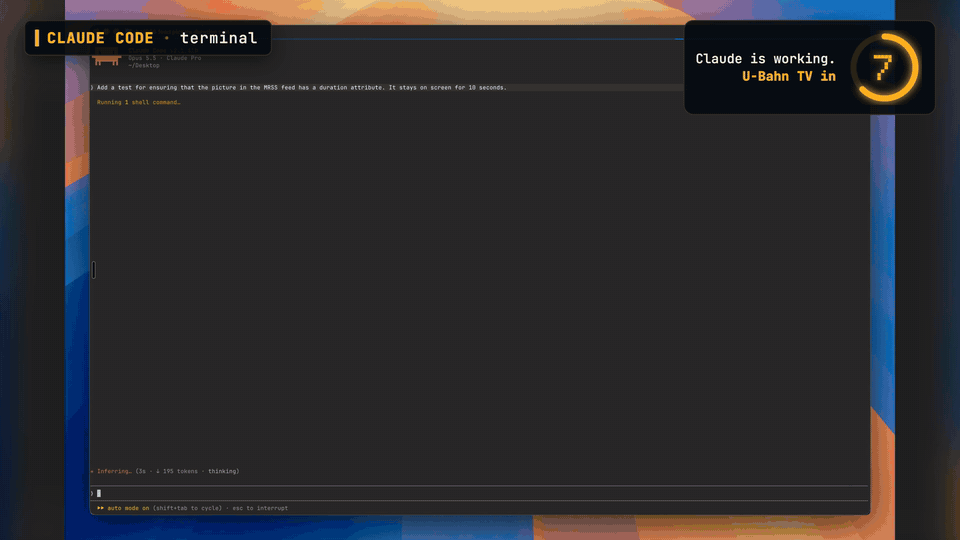
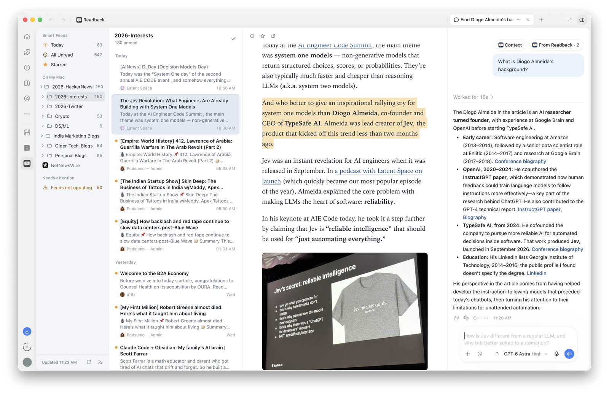

# NueFunnel Labs: Claude and ChatGPT mods

Experimental plugins from [NueFunnel](https://www.nuefunnel.com) that add something to the AI apps you already use: one for Claude Code, one for the ChatGPT desktop app. Each runs on your own computer and collects nothing.

| Plugin | App | What it does |
| :- | :- | :- |
| [U-Bahn TV](./ubahn-tv) | Claude Code | Plays Nuremberg's U-Bahn passenger TV, or any Media RSS feeds, in a side pane while Claude works |
| [Readback](./readback) | ChatGPT desktop app | A NetNewsWire-style RSS reader in ChatGPT's side panel: select a passage and ask about it in the chat beside it |

## U-Bahn TV

When a Claude Code turn runs longer than 10 seconds, a pane opens beside the conversation and plays a loop of clips, like the screens on the Nuremberg U-Bahn. It closes when the turn ends. It works in the terminal (Ghostty or kitty) and in the Claude Desktop app.



**Watch the full demo (1 min):** U-Bahn TV in Claude Code in the terminal and in the Desktop app

https://github.com/user-attachments/assets/96883513-06c4-486a-bc7e-d26870f9b5e9

In Claude Code:

```
/plugin marketplace add nuefunnel/nuefunnel-labs
/plugin install ubahn-tv@nuefunnel-labs
```

It needs `ffmpeg`. Requirements, settings and feeds: **[ubahn-tv/README.md](ubahn-tv/README.md)**.

## Readback

Your RSS feeds in a three-pane reader inside the ChatGPT desktop app on your Mac. Import from NetNewsWire or an OPML file, read in the side panel, and select any passage to get **Ask**, **Explain** or **Fact-check** in the chat docked beside it. Nothing you read goes to ChatGPT until you ask.



In the ChatGPT desktop app, open **Plugins → Add a marketplace**, enter `nuefunnel/nuefunnel-labs`, and install **Readback**.

It needs Node.js 22.13 or newer. Requirements, how to check Node, and your data: **[readback/README.md](readback/README.md)**.

## Privacy

Neither plugin has servers, accounts or analytics. Each one's privacy policy says exactly what it fetches and stores: [U-Bahn TV](ubahn-tv/PRIVACY.md), [Readback](readback/PRIVACY.md).

## Develop

U-Bahn TV:

```
claude plugin validate ./ubahn-tv     # manifest, hooks and the mods API calls it makes
claude plugin test ./ubahn-tv         # unit and drawing tests, no session needed
claude --plugin-dir ./ubahn-tv        # one session, reloads on save
```

Readback: see [Develop](readback/README.md#develop) in its README.

## License

[MIT](LICENSE)
