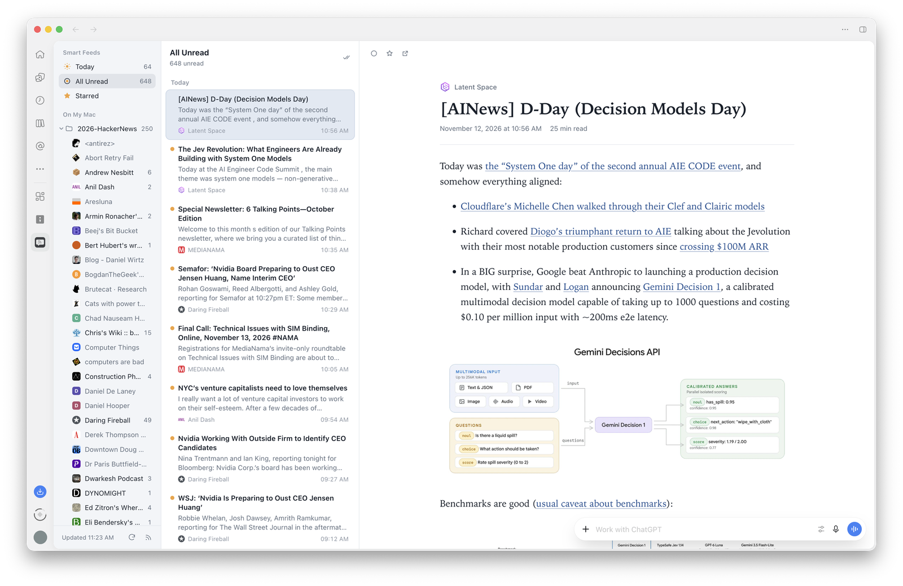
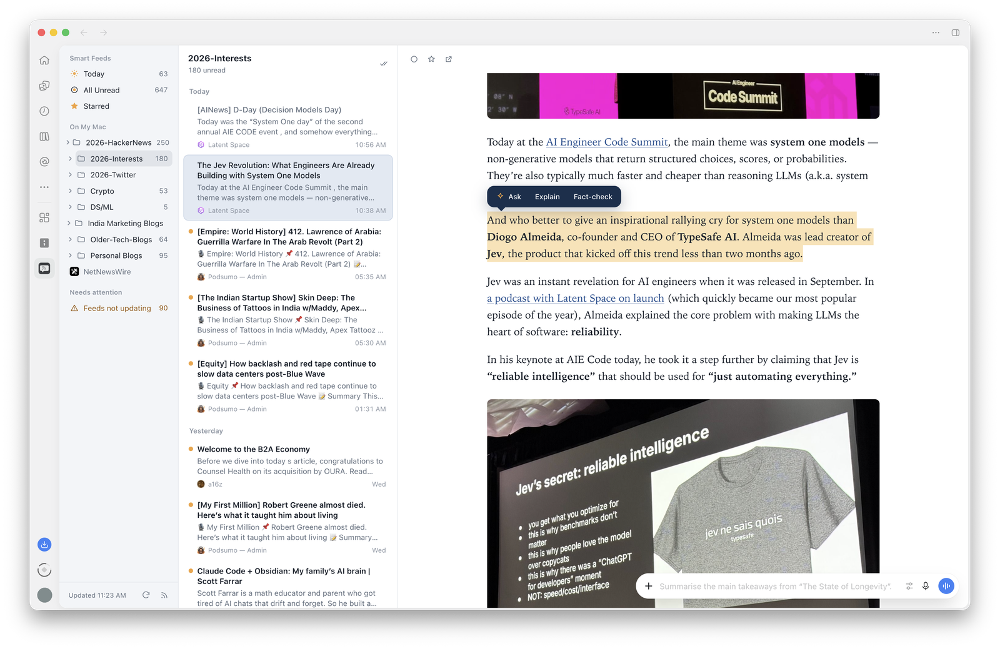
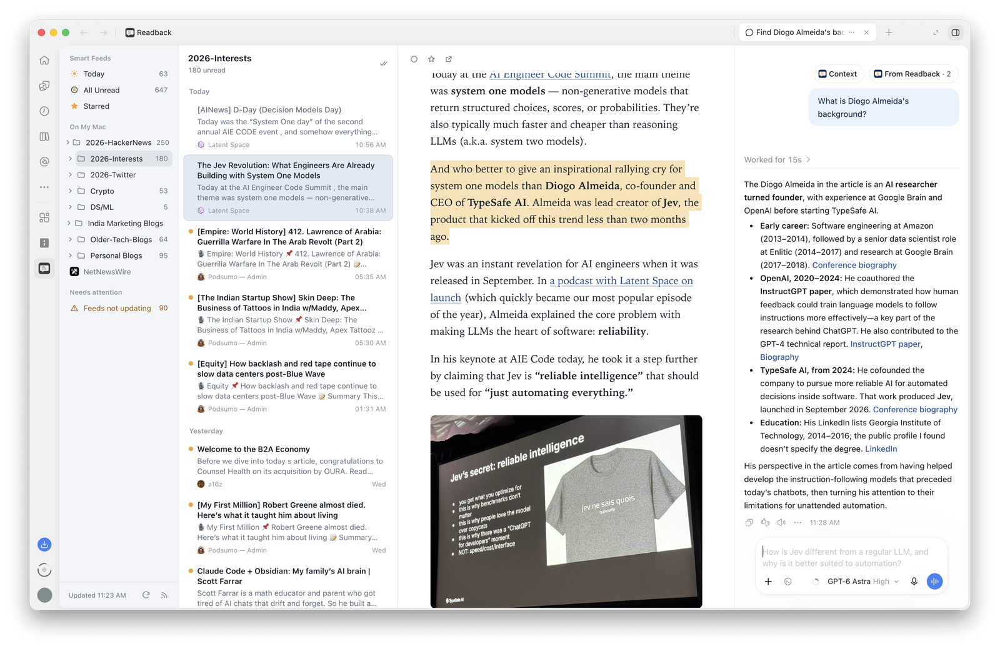
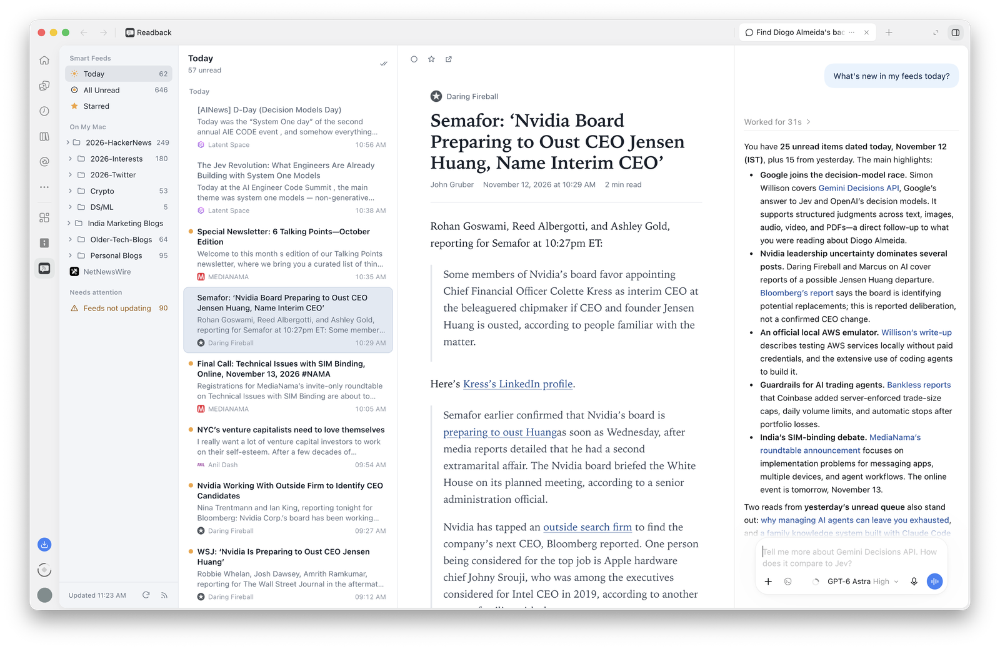

# Readback

A NetNewsWire-style RSS reader inside the ChatGPT desktop app. Read your feeds in a three-pane view in ChatGPT's side panel, and select any passage to ask about it in the chat docked beside it.



Everything runs on your Mac. The ChatGPT app starts Readback's small local server itself while it's open; there is no account, no cloud service, and nothing to host.

## Requirements

- **macOS** and the **ChatGPT desktop app**. Readback doesn't work in ChatGPT on the web or on a phone, because those can't reach a server on your Mac.
- **Node.js 22.13 or newer.** Readback's server is a Node program, and it uses Node's built-in SQLite, which arrived in 22.13.

### Checking and installing Node

Open Terminal and run:

```
node -v
```

If it prints `v22.13.0` or higher (for example `v24.11.0`), you're set. If it says `command not found` or shows an older version, install the current LTS release in one of these ways:

- **Installer:** download the macOS installer from [nodejs.org](https://nodejs.org/en/download) and run it.
- **Homebrew:** `brew install node`

Then quit and reopen ChatGPT so it picks up the new `node`.

The ChatGPT app starts Readback with the `node` it finds on your `PATH`. The installer and Homebrew both put `node` where the app finds it. Version managers such as nvm or fnm install Node inside your shell profile, and we haven't tested whether the app sees those; if Readback doesn't appear after installing, use the installer or Homebrew.

If Node is too old, Readback doesn't open its reader. Instead it writes the reason to `events.log` and tells ChatGPT, so asking in the chat ("Open Readback") gets you an answer saying which Node it found and how to fix it. If Node is missing altogether, the app can't start Readback at all, so it simply doesn't appear. Either way, Node is the first thing to check.

## Install

In the ChatGPT desktop app:

1. Open **Plugins**, then **Add a marketplace**.
2. For the source, enter `nuefunnel/nuefunnel-labs`.
3. Open **Readback** in the NueFunnel Labs marketplace and install it.
4. Readback appears in the side rail. Open it, then bring in your subscriptions.

## What it looks like

Select a passage to get **Ask**, **Explain** and **Fact-check**:



The answer appears in the chat docked beside the reader:



Or ask about your feeds in the chat, such as "What's new in my feeds today?":



## Bringing in your feeds

- **From NetNewsWire on this Mac:** the welcome screen offers to import NetNewsWire's list directly.
- **From an OPML file:** choose **Choose an OPML file…**, or ask in the chat: "Import my OPML from ~/Downloads/Subscriptions.opml".
- **One feed:** open Subscriptions (the RSS icon at the bottom of the sidebar) and paste a website or feed address.

Re-importing is safe: feeds you already follow are skipped, and folders follow the newer file. When a feed is first added, only its last 7 days start out unread.

## Using it

- Select text in an article to get **Ask**, **Explain** and **Fact-check**. The question goes to the ChatGPT chat beside the reader.
- Drag the dividers between the panes to resize them; double-click a divider to reset.
- Keys: `j` / `k` next and previous, `n` next unread, `space` scroll then next unread, `m` read or unread, `s` star, `b` open in browser, `r` refresh.
- Feeds are checked every 30 minutes while ChatGPT is open. Feeds that keep failing are listed under **Needs attention**, with plain reasons and a way to unsubscribe.

## Your data

Everything lives in `~/Library/Application Support/Readback/`:

| File | What it holds |
| :- | :- |
| `readback.sqlite` | Subscriptions, articles, read and starred state, settings |
| `images/` | Article images, fetched once and shrunk if large |
| `events.log` | What the server did; useful when something goes wrong |

Readback cleans up after itself once a day:

- Read articles older than 90 days are deleted. Unread and starred articles are always kept.
- The image cache is capped at 300 MB; the least recently viewed images go first.
- The database file is compacted when it has a lot of free space.

### What goes to ChatGPT

[PRIVACY.md](PRIVACY.md) has the full privacy policy.

Nothing about what you read is sent to ChatGPT until you ask. When you use Ask, Explain or Fact-check, the open article's text and your selection go with the question. If you ask in the chat about your feeds ("What's new today?"), ChatGPT reads titles or an article through Readback's tools.

Readback itself only contacts the sites you subscribe to, to fetch their feeds, images and icons.

## Troubleshooting

- **Readback doesn't appear or won't open:** check Node (see above), then quit and reopen ChatGPT.
- **Something looks wrong:** look at the end of `~/Library/Application Support/Readback/events.log`.
- **A feed isn't updating:** see **Needs attention** in the sidebar.

## Uninstall

Uninstall Readback from **Plugins** in the ChatGPT app. To remove your data too, delete `~/Library/Application Support/Readback/`.

## Develop

```
npm install
npm run build     # writes dist/ui.html and dist/server.mjs (dist/ is committed: installs don't build)
npm test
npm run preview   # the reader in a browser at http://localhost:8799, using a copy of your data
```

The app starts `launch.mjs`, which checks the Node version and then loads `dist/server.mjs`. Because the app runs `dist/` as committed, always build before committing a change to `src/`; a GitHub check fails when `dist/` doesn't match a fresh build.

To release a new version, change `version` in both `package.json` and `.codex-plugin/plugin.json`, then build. The build writes the version into the server and stops if the two files disagree.

## License

[MIT](../LICENSE)
